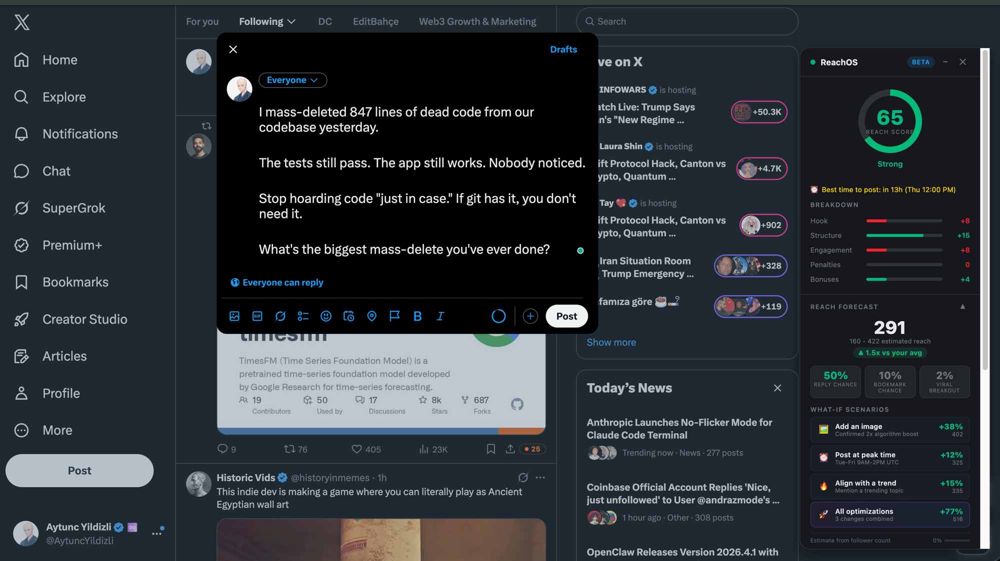

<p align="center">
  <h1 align="center">ReachOS</h1>
  <p align="center">Open-source reach optimizer for X/Twitter. Know your reach before you post.</p>
</p>

<p align="center">
  <a href="#features">Features</a> &bull;
  <a href="#how-it-works">How It Works</a> &bull;
  <a href="#quick-start">Quick Start</a> &bull;
  <a href="#deploy-your-own">Deploy Your Own</a> &bull;
  <a href="#architecture">Architecture</a> &bull;
  <a href="#contributing">Contributing</a>
</p>

---

ReachOS is a Chrome extension that scores your tweets in real time against 25 signals (the 22-signal taxonomy [xAI published on 2026-05-15](https://github.com/xai-org/x-algorithm), plus topic consistency, ad disclosure, and post frequency) and shows you what to change. A numeric reach interval is shown only after your own posts beat your usual reach on held-out history. Until then the forecast says **uncalibrated** and the checklist is the output. BYOK (Bring Your Own Keys) — fully self-hostable.

```
You type a tweet.
ReachOS scores the checklist as you type.
Until your history beats your usual reach, the forecast says "uncalibrated".
```

> **v4.0 (May 2026):** ReachOS realigned to xAI's published Phoenix-era algorithm. Outbound links are no longer penalized; instead, descriptive link anchors with a curiosity gap drive the new `click` signal. See [CHANGELOG.md](CHANGELOG.md) for the full migration notes.

## Features

### Score Overlay + Reach Forecast
Real-time 0-100 score as you type in the X.com composer. Signal bars grouped into 4 buckets — Engagement, Curiosity, Dwell, Risk — summing 25 signal predictors. Reach Forecast shows an interval only when a per-account model beats that account's rolling median on newer posts. Otherwise it stays uncalibrated.



### X-Ray Mode
Scores every tweet on your timeline as you scroll. Color-coded pills (red/orange/yellow/green/blue/purple) show reach potential at a glance.


### AI-Powered Analysis (BYOK)
- **AI Slop Detection** - Flags AI-sounding language (28 weighted patterns + Claude verification)
- **Hook Quality Assessment** - 6-dimension analysis of your opening line
- **Auto-Optimize** - 5 rounds of iterative AI rewriting, keeps the best version
- **Self-Reply Generator** - Creates a self-reply to kickstart conversation (150x algorithm boost)

### Smart Signals
- **Trending Alignment** - Detects when your tweet matches trending topics (+5 bonus)
- **Posting Time Optimizer** - Shows whether now is a good time to post based on research-backed UTC windows
- **Reply Coach** - Notifies you about unanswered replies on tracked tweets
- **Account Health** - 5-factor health score with actionable tips

### Self-Learning Loop
For signed-in users, the system gets smarter over time:

```
Post tweet → Save prediction → Fetch real metrics (15min)
    → Fit a per-account model on older posts, test it on newer posts
    → Show a reach interval only if that model beats your rolling-median reach
    → Otherwise the forecast stays uncalibrated and the checklist remains
    → Learn which signals lift YOUR tweets (daily, needs 5+ tracked tweets)
    → Your Reach Score applies those learned weights (±6 points per signal)
```

## How It Works

### Scoring Engine (25 Signals)

ReachOS v4.2 mirrors the 22 signals scored by `home-mixer/scorers/ranking_scorer.rs` in `xai-org/x-algorithm`, plus 3 ReachOS-original predictors covering ad-disclosure, daily post-frequency decay, and microniche topical consistency. Each signal has its own predictor file in [`packages/rules-engine/src/signals/`](packages/rules-engine/src/signals/) — and every xAI signal name matches the Rust source exactly. A reach number is a per-account model judged on newer posts; if it does not beat that account's rolling median, the forecast stays uncalibrated and the checklist is the output.

| Bucket | Signals | What it predicts |
|--------|---------|------------------|
| **Engagement** | favorite, reply, retweet, quote, share, share_via_dm, share_via_copy_link, click, photo_expand, vqv, quoted_click, quoted_vqv | Direct positive interactions X scores explicitly |
| **Curiosity** | profile_click, follow_author | "Who is this person?" → audience-growth signal |
| **Dwell** | dwell, cont_dwell_time, cont_click_dwell_time | Reader stays vs. scrolls past |
| **Risk** | not_dwelled, not_interested, block_author, mute_author, report | Negative actions X scores as soft/hard penalties |

Base score 30 + Σ positive signal predictors (max 95) + Σ negative signal predictors (min −50), clamped to 0–100. Five signals are **conditional**: `photo_expand` (needs image), `vqv` (needs video), `cont_click_dwell_time` (needs clickable content), `quoted_click` / `quoted_vqv` (need quote-tweet).

### Key signal weights (mirror of `ranking_scorer.rs`)

| Signal | Max points | Why this weight |
|--------|-----------|-----------------|
| `reply` | +12 | X's king positive signal (confirmed ~27× like in 2023 leak; retained in May 2026) |
| `click` | +8 | **Replaces v3's link penalty.** X scores URL clicks as a positive engagement |
| `dwell` | +8 | Single-view dwell, scored independently of `cont_dwell_time` |
| `favorite` | +7 | Likes — broad signal but lower per-action than reply |
| `profile_click` | +7 | Curiosity → follow funnel |
| `retweet` | +7 | Quotable, succinct content |
| `share_via_dm` | +6 | NEW in May 2026: DM-share scored as its own signal |
| `quote` | +6 | Quote-tweet-worthiness (contrarian claims drive this) |
| `share` | +5 | Generic broadcast share |
| `follow_author` | +5 | Follow conversion |
| `photo_expand` | +4 | Conditional on image attached |
| `vqv` | +4 | Conditional on video attached |
| `not_dwelled` | −12 | Scroll-past risk |
| `report` | −15 | Hardest negative (mirrors ~−738× like in 2023 leak) |

> What's **removed** from v3.0: outbound-link penalty, 3+ hashtag penalty, unknown-language penalty, competitor-mention penalty. None have any visible representation in X's May-2026 published code.

### Reach Forecast

The checklist score is not a reach prediction. A number is a separate model, and it is withheld when that model does not beat the account's recent typical impressions.

The forecast fits a ridge regression per account:

- Features: the 25 signal scores, plus length, line breaks, numbers, links (`has_link` and link count), media, quote vs original, language, hour and weekday in the account's timezone, recency, and the account's past rolling median impressions.
- Quote features, known at compose time: `q_present`, `log1p(quoted author followers)`, `log1p(quoted post age in hours)`, and `q_self` (a self-quote). Parsed from `quoted` plus `quoted_author_followers` and `quoted_post_age_at_quote_h`.
- `q_rel_imp` = `log(quoted impressions + 1) − log(baseline)` is **off** unless you pass `--quoted-impressions`. That count is measured at fetch time, after the quote exists, so the quote has already added views. It is partly leaky. A live model may use it only from a count read at compose time.
- `follower_count` / `followerCount` / `followers`, or `follower_snapshots: [{ at, followers }]`, is the follower count dated to that post. A count that does not vary inside the account is dropped. A single current follower total copied onto every post is not a feature.
- Impression target: `log(impressions / rolling median of earlier posts)`.
- Engagement target: engagement rate minus its own rolling median. Rate is `(likes + reposts + replies + quotes) / impressions`.
- Split: train on older posts, test on newer posts. Rolling baselines use only earlier posts.
- A number is shown only when the holdout has at least 40 training posts and 20 test posts, Spearman is positive and above the rolling median, and **raw MAE** is at least 5% lower. The UI then shows an 80% interval, not a single exact count.
- log-MAE and median absolute error are printed beside that result. They do **not** decide the impression gate. The 5% raw-MAE bar was fixed before these files were scored and is unchanged.
- Otherwise the forecast is **uncalibrated**. What-if multipliers (image ×1.35, and the rest of the old chain) are not shown.

Pooled mode fits one ridge on several accounts. Each account still gets its own rolling baseline and its own 70/30 time split. The sorted-first account is the intercept; the others get a one-hot column. Pass more than one JSON file, or put an `account` field on each post. One account makes the dummy a constant, so the pooled fit matches the per-account fit. A pooled fit is not what the extension ships. The live number still requires that account's own raw-MAE gate.

```bash
pnpm --filter @reach/rules-engine backtest -- posts.json --timezone Europe/Istanbul --as-of 2026-10-27T00:00:00.000Z
pnpm --filter @reach/rules-engine backtest -- a.json b.json --pooled --timezone Europe/Istanbul --quoted-impressions
```

Early-engagement mode reads rows shaped like a `metric_snapshots` export: `{ id | post_id, age_h: 1|6|24|48|168 | target: "1h"|"6h"|"24h"|"48h"|"7d", metrics }`. It predicts 7-day impressions from the 1h and 6h snapshots (24h and 48h are accepted and not used, because they are later than a 6-hour decision). Features are `log(impressions / rolling median of earlier posts at that age)` at 1h and 6h, `log(imp_6h / imp_1h)`, and the engagement rate at those two ages. The baseline is `impressions_1h × median(impressions_7d / impressions_1h)` on that account's training posts.

The pre-registered gate for this mode is **log-MAE**, at least 5% lower than that 1h multiplier, with the same size and Spearman rules. It becomes the decision only when this mode is scored on a fresh forward holdout of snapshot data. It is not applied to impression files that have already been seen, and it does not replace the raw-MAE gate above. Snapshot fits are not written into the compose-time forecast.

```bash
pnpm --filter @reach/rules-engine backtest -- --snapshots snapshots.json
```

`--study` scores a fixed menu on the newest 25% of each account's training span, locks one winner, then scores the newest 30% once. The menu is the current relative-lift ridge, an absolute log target, shrink `baseline × exp(k · lift)` with k chosen inside the fit span, Huber, depth-2 gradient boosting, extra text/schedule/quote-relative/EWMA features, self-replies, and a type EWMA competitor. The 5% raw-MAE gate is the same one. On the six-account files every row lost to the rolling median on that inner slice, Huber lost least, and its sealed holdout also failed (−0.4% MAE). The default model is unchanged. The type EWMA was worse than the rolling median, so it is not a stronger baseline on these files. The open lever is a 1h/6h impression snapshot: caption, clock, and quote features do not move raw error by 5% once the account's recent median is known.

```bash
pnpm --filter @reach/rules-engine backtest -- a.json b.json --study --timezone Europe/Istanbul
```

`posts.json` is an array of posts with `public_metrics` (the X API post shape). Replies, posts younger than 3 days, captions with no scorable text, and duplicate captions are dropped from the fit. Posts from the last 3 days stay in the live recency and topic context; their impressions are still moving, so they stay out of the rolling baseline. The daily calibrate cron fits the per-account model for tracked tweets and stores it on the user. The extension reads that snapshot, refreshing account health when the cache is missing, and shows the checklist when no model has passed.

## Quick Start

### 1. Clone and install

```bash
git clone https://github.com/AytuncYildizli/reach-optimizer.git
cd reach-optimizer
pnpm install
```

### 2. Set up environment

```bash
cp .env.example apps/api/.env.local
# Edit apps/api/.env.local with your keys
```

**No server required for the checklist.** The extension scores tweets locally with 25 signals (81 sub-rules). No keys, no database, no setup. A reach number needs the account's own metrics and a model that beats its baseline.

If you want to self-host the API for AI features:

| Key | Where to get it | Required? |
|-----|-----------------|-----------|
| `DATABASE_URL` | [Neon](https://neon.tech) (free tier) or any PostgreSQL | For tracking + dashboard |
| `JWT_SECRET` | `openssl rand -hex 32` | For auth |
| `ANTHROPIC_API_KEY` | [Anthropic Console](https://console.anthropic.com) | For AI analysis (optional) |
| `X_CLIENT_ID` | [X Developer Portal](https://developer.x.com) | For "Connect X" login (optional) |
| `X_CLIENT_SECRET` | X Developer Portal | For "Connect X" login (optional) |
| `TWITTER_API_IO_KEY` | [twitterapi.io](https://twitterapi.io) | For trending + metrics (optional) |
| `CRON_SECRET` | `openssl rand -hex 32` | Protects cron endpoints. **Required in production**: without it the cron routes reject every request |
| `ALLOWED_ORIGINS` | `chrome-extension://<your unpacked id>` | Extra origins allowed by CORS (optional; the store extension is always allowed) |

### 3. Push database schema

```bash
cd apps/api
npx prisma db push
```

### 4. Run locally

```bash
# From repo root
pnpm dev
```

API runs on `http://localhost:3100`.

### 5. Load the Chrome extension

```bash
pnpm --filter @reach/extension build
```

1. Open `chrome://extensions`
2. Enable "Developer mode"
3. Click "Load unpacked"
4. Select `apps/extension/dist/`
5. Go to X.com and start typing a tweet

### 6. Configure API URL (for local dev)

The extension points to `https://reach-optimizer.vercel.app` by default. For local development, update the API base URL in `apps/extension/src/background/service-worker.ts`:

```typescript
const API_BASE = 'http://localhost:3100';
```

## Deploy Your Own

### One-Click Vercel Deploy

[](https://vercel.com/new/clone?repository-url=https://github.com/AytuncYildizli/reach-optimizer&env=DATABASE_URL,JWT_SECRET,X_CLIENT_ID,X_CLIENT_SECRET&envDescription=Required%20environment%20variables&envLink=https://github.com/AytuncYildizli/reach-optimizer/blob/main/.env.example)

After deploying:

1. Set up a [Neon](https://neon.tech) PostgreSQL database (free tier works)
2. Add your environment variables in Vercel dashboard
3. Run `npx prisma db push` against your production database
4. Update the extension's API URL to your Vercel deployment
5. Build and load the extension

### Cron Jobs

The API includes 4 cron jobs (auto-configured on Vercel):

| Cron | Schedule | What It Does |
|------|----------|-------------|
| `/api/cron/fetch-metrics` | Every 15 min | Fetches real engagement metrics for tracked tweets |
| `/api/cron/auto-optimize-pending` | Daily 03:00 UTC | Batch-optimizes pending tweets from ops DB |
| `/api/cron/learn-weights` | Daily 04:00 UTC | Analyzes which rules predict real engagement |
| `/api/cron/calibrate-forecast` | Daily 05:00 UTC | Compares predicted reach vs actual, auto-corrects |

## Architecture

```
┌─────────────────────────────────────────────────────────────┐
│                    Chrome Extension                         │
│                                                             │
│  ┌──────────────┐  ┌──────────────┐  ┌──────────────────┐  │
│  │  Composer     │  │  Score       │  │  X-Ray Mode      │  │
│  │  Detector     │  │  Overlay     │  │  (timeline)      │  │
│  │  (DOM watch)  │  │  (React)     │  │                  │  │
│  └──────┬───────┘  └──────┬───────┘  └──────────────────┘  │
│         │                 │                                  │
│         ▼                 ▼                                  │
│  ┌──────────────────────────────┐                           │
│  │     Rules Engine (client)    │  25 signals, instant      │
│  │     @reach/rules-engine      │  scoring on every         │
│  └──────────────┬───────────────┘  as you type              │
│                 │                                            │
│                 ▼  (after 2s idle)                           │
│  ┌──────────────────────────────┐                           │
│  │   Service Worker (proxy)     │                           │
│  │   Adds auth header, routes   │                           │
│  │   API calls                  │                           │
│  └──────────────┬───────────────┘                           │
└─────────────────┼───────────────────────────────────────────┘
                  │
                  ▼
┌─────────────────────────────────────────────────────────────┐
│                    Next.js API (Vercel)                      │
│                                                             │
│  ┌────────────┐  ┌────────────┐  ┌──────────────────────┐  │
│  │ /analyze   │  │ /suggest   │  │ /account-health      │  │
│  │ AI delta   │  │ Hook/CTA   │  │ X profile + health   │  │
│  │ only       │  │ rewrites   │  │ score                │  │
│  └─────┬──────┘  └────────────┘  └──────────────────────┘  │
│        │                                                     │
│  ┌─────▼──────────────────────────────────────────────────┐ │
│  │  Claude AI (BYOK)                                      │ │
│  │  - Slop detection (heuristic + LLM)                    │ │
│  │  - Hook quality (6 dimensions)                         │ │
│  │  - Rewrite suggestions (3 variants)                    │ │
│  └────────────────────────────────────────────────────────┘ │
│                                                             │
│  ┌────────────────────────────────────────────────────────┐ │
│  │  PostgreSQL (Neon)                                     │ │
│  │  Users, Analyses, TrackedTweets, TweetMetrics          │ │
│  └────────────────────────────────────────────────────────┘ │
└─────────────────────────────────────────────────────────────┘
```

### Monorepo Structure

```
reach-optimizer/
├── apps/
│   ├── api/                    # Next.js 15 API
│   │   ├── app/api/            # 18 API routes
│   │   ├── app/dashboard/      # Web dashboard
│   │   ├── lib/                # Auth, DB, trending, scoring
│   │   └── prisma/schema.prisma
│   └── extension/              # Chrome Extension (Manifest V3)
│       ├── src/content/        # Score overlay, X-Ray, forecast engine
│       ├── src/popup/          # Extension popup (auth, settings)
│       └── src/background/     # Service worker (API proxy)
├── packages/
│   ├── rules-engine/           # 25 signals, 81 sub-rules, forecast model
│   │   ├── src/signals/        # one predictor per signal
│   │   ├── src/forecast/       # ridge model + backtest CLI
│   │   ├── src/config/         # weights.json
│   │   └── src/__tests__/      # 75 tests
│   ├── ai-checks/              # AI analysis (Claude integration)
│   │   ├── src/analyzer.ts     # Slop + hook + suggestions
│   │   ├── src/slop-detector.ts # 28 heuristic patterns
│   │   └── src/__tests__/      # 13 tests
│   └── shared-types/           # TypeScript types for all packages
├── docs/
│   └── prd-self-learning-reach-engine.md
├── .env.example
├── vercel.json                 # Cron jobs + deploy config
└── turbo.json                  # Turborepo config
```

## API Reference

### Core

| Endpoint | Method | Auth | Description |
|----------|--------|------|-------------|
| `/api/analyze` | POST | Optional | AI analysis delta (slop, hook, trending) |
| `/api/suggest` | POST | JWT | Hook rewrites or self-reply generation |
| `/api/tweets/auto-optimize` | POST | JWT | 5-round iterative AI rewriting |
| `/api/tweets/reply-suggestions` | POST | JWT | Reply templates for engagement |
| `/api/tweets/suggestions` | GET | JWT | Personalized tweet ideas |

### Tracking & Intelligence

| Endpoint | Method | Auth | Description |
|----------|--------|------|-------------|
| `/api/tweets/track` | POST | Optional | Save posted tweet + predicted reach |
| `/api/tweets/metrics` | GET | JWT | Real engagement metrics for tracked tweets |
| `/api/account-health` | GET | JWT | 5-factor account health + reach multiplier |
| `/api/timing` | GET/POST | No | Optimal posting time windows by timezone |
| `/api/trending` | GET | No | Currently trending topics on X |
| `/api/weights` | GET | Optional | Personalized weight adjustments |
| `/api/calibration/report` | GET | JWT | Score vs outcome correlation report |

### Auth

| Endpoint | Method | Description |
|----------|--------|-------------|
| `/api/auth/login` | GET | Initiates X OAuth 2.0 PKCE flow |
| `/api/auth/callback` | GET/POST | Exchanges code for JWT |

## Running Tests

```bash
# Package tests (104 passing: 91 rules-engine + 13 ai-checks)
pnpm test

# Rules engine only (91 tests)
pnpm --filter @reach/rules-engine test

# Time-ordered backtest against one or more posts files
pnpm --filter @reach/rules-engine backtest -- posts.json --timezone Europe/Istanbul
pnpm --filter @reach/rules-engine backtest -- a.json b.json --pooled --quoted-impressions
pnpm --filter @reach/rules-engine backtest -- a.json b.json --study
pnpm --filter @reach/rules-engine backtest -- --snapshots snapshots.json

# Type checking
pnpm typecheck
```

## Tech Stack

| Layer | Technology |
|-------|-----------|
| Extension | React 19, Vite, Manifest V3, Shadow DOM |
| API | Next.js 15, Vercel Serverless |
| Database | Prisma 6, PostgreSQL (Neon) |
| AI | Anthropic Claude (Haiku 4.5 for speed, Sonnet 4.6 for ideas) |
| Monorepo | Turborepo, pnpm |
| Language | TypeScript (strict) |

## Contributing

See [CONTRIBUTING.md](CONTRIBUTING.md) for how to add rules, fix bugs, and submit PRs.

## Further Reading

- [I Read X's Open-Source Algorithm — Here's What Actually Matters in 2026](https://hackernoon.com/i-read-xs-open-source-algorithm-heres-what-actually-matters-in-2026) - Deep dive on the same algorithm signals ReachOS scores against
- [twitter/the-algorithm](https://github.com/twitter/the-algorithm) - X's open-sourced recommendation algorithm (primary source for our rules)

## License

MIT - see [LICENSE](LICENSE).
